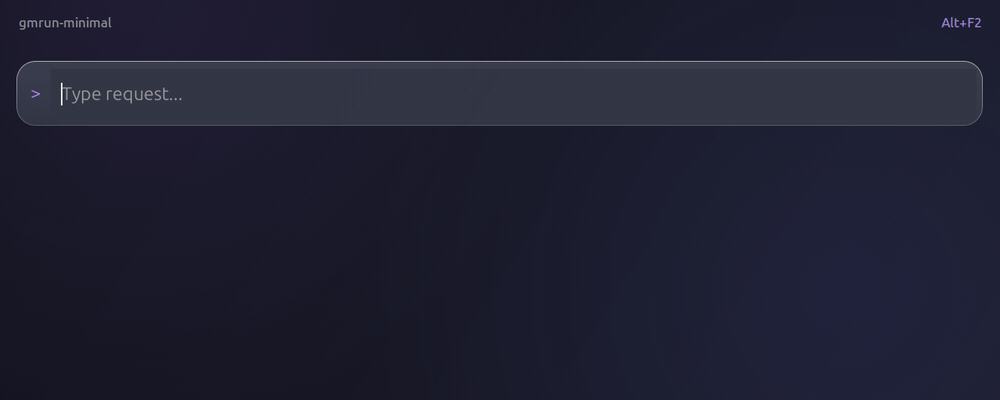

# gmrun-minimal



A centered command bar for [gmrun](https://github.com/wdlkmpx/gmrun), with
[Dracula colors](https://draculatheme.com/contribute#color-palette), larger text
and a borderless layout. Tab completion and command history
work as usual. A small GTK2 module hides the header and adjusts the layout.

Tested with gmrun 0.9.2 on Ubuntu 24.04, GNOME/X11.

## Install

```sh
sudo apt install gmrun gnome-terminal gtk2-engines-murrine build-essential pkg-config libgtk2.0-dev
make install
~/.local/bin/gmrun-minimal
```

In GNOME Settings, assign Alt+F2 to the full path of `~/.local/bin/gmrun-minimal`.
Replace any existing Alt+F2 shortcut. Installation backs up existing configuration
files; run `make uninstall` to restore them.

[Installation and configuration](docs/setup.md) covers keyboard shortcuts, colors,
fonts and terminal commands.

## License

[MIT](LICENSE). gmrun and GTK remain separate dependencies with their own licenses.
